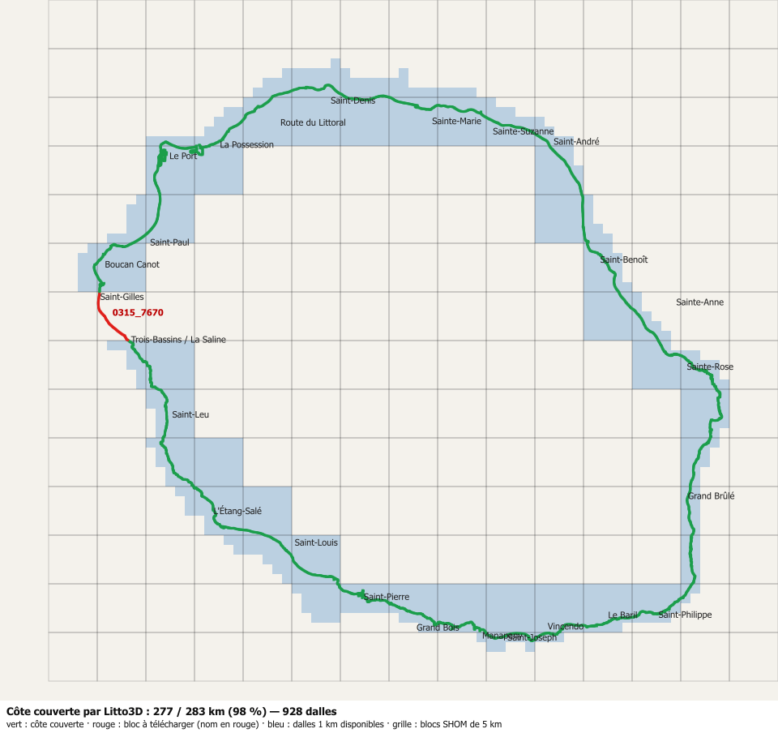

# Sources de données — littoral et relief de La Réunion

Catalogue des données **brutes téléchargées** (hors services web) utilisées par TERLAB et par la maquette de ville de `code-runner` (`tools/city/`). Les services interrogés en direct (PEIGEO, Géorisques, WFS BD TOPO, WMS COSIA…) sont décrits dans la skill `.claude/skills/sig-donnees-reunion`.

Les données lourdes sont rangées dans `docs/sources/<source>/` et **ne sont jamais commitées** (`.gitignore`). Ce fichier, lui, est versionné : il dit ce qu'on a, d'où ça vient, sous quelle licence, et comment le refaire.

Dernière mise à jour : 28/09/2026.

---

## 1. Litto3D® Réunion 2016 — MNT terre-mer 1 m

| | |
|---|---|
| Producteur | SHOM + IGN (programme national Litto3D), en partenariat avec la préfecture de La Réunion |
| Téléchargement | [diffusion.shom.fr — Litto3D Réunion 2016](https://diffusion.shom.fr/donnees/altimetrie-littorale/litto3d-reunion2016.html), archives `.7z` par bloc de 5 km |
| Licence | Licence Ouverte Etalab **version 1.0** (octobre 2011), d'après les fiches XML des blocs : utilisation libre sous réserve de **citer la source** (« Litto3D® Réunion 2016 — SHOM / IGN ») ; **ne pas utiliser pour la navigation** |
| Dates réelles des mesures | **2008 à 2011** (LiDAR topographique 2008, LiDAR bathymétrique 2009-2011) ; « 2016 » est la date de livraison. Écart d'environ 15 ans avec le LiDAR HD (2025) : ports, travaux et érosion récents n'y sont pas |
| Spécification | [Descriptif de contenu Litto3D](https://services.data.shom.fr/static/specifications/DC_Litto3D.pdf) |
| Emplacement local | `docs/sources/litto3d/<secteur>/<bloc>/LITTO3D_REU_<E>_<N>_…/MNT1m/*.asc` |
| Format utilisé | MNT maillé 1 m, ASCII Grid (`.asc`), une dalle de 1 km par fichier (~7 Mo), `-99999` = sans donnée |
| Catalogue machine | `docs/sources/litto3d-catalogue.json`, généré (voir § 1.4) |

### 1.1 Contenu d'une dalle
Chaque dossier `LITTO3D_REU_<E>_<N>_20160502_…` contient :

| Dossier | Contenu | Format | Utilisé aujourd'hui |
|---|---|---|---|
| `MNT1m/` | MNT 1 m | ASC (~7 Mo) | oui : bathymétrie, classes du littoral, coupes |
| `MNT5m/` | MNT 5 m | ASC (~0,3 Mo) | non (candidat pour la vue lointaine) |
| `Masque_Source/` | technique ayant servi à chaque nœud (voir § 1.2) | GeoTIFF | non (candidat pour distinguer récif, sable et roche) |
| `Masque_Distance/` | distance au point mesuré le plus proche, en m | GeoTIFF | non (candidat pour écarter les zones interpolées) |
| `Semis_points/` | points mesurés bruts | XYZ (~8 Mo) | non |
| `Texte/` | fiche de la dalle : date, nombre de points, zmin/zmax, instruments et périodes d'acquisition | texte (latin-1) | oui : catalogue |

### 1.2 Masque de source (spécification § 4.1.4)
| Code | Signification |
|---|---|
| 0 | aucune donnée |
| 28 / 29 | LiDAR mixte topo-bathy / idem interpolé à plus de 10 m |
| 30 / 39 | LiDAR bathymétrique / idem interpolé à plus de 10 m |
| 40 / 49 | sondeur multifaisceau / idem interpolé à plus de 10 m |
| 50, 5n | LiDAR topographique (densité inconnue ou < 1 pt/m², ou n pts/m²) ; 59 = interpolé à plus de 10 m |
| 60, 6n | altitude translatée depuis le modèle de surface LiDAR topo ; 68 = LiDAR topo sans correction interactive ; 69 = point fictif |
| 70 | origines multiples |

Masque de distance : 255 = nœud sans altitude, 254 = nœud de raccord, 253 = sans objet (MNT externe), sinon la distance d'interpolation en mètres (0 = moins de 1 m).

**Repères** : planimétrie RGR92 / UTM 40S (EPSG:2975). Altitudes en **REUN89 (IGN89, EPSG:5758)**, y compris sous l'eau : la spécification (§ 2.4.2) indique que le système d'altitudes est « toujours le système d'altitudes légal sur la zone ». Les profondeurs ne sont donc **pas** rapportées au zéro hydrographique.

**Précision annoncée** : meilleure que 20 cm en zone émergée et que 30 cm en zone immergée (à 95 %). À terre, les données viennent du LiDAR topographique ; en mer, du LiDAR bathymétrique ou d'un sondeur. Les deux acquisitions se recouvrent sur 300 m.

### 1.3 Nommage des blocs et des dalles
- **Bloc** (archive de 5 km) : `<E km du bord ouest>_<N km du bord NORD>`, par exemple `0340_7640` couvre E 340–345 km et N 7 635–7 640 km.
- **Dalle** (1 km) : même convention, `LITTO3D_REU_0341_7639_…` couvre E 341–342 et N 7 638–7 639.
- ⚠ Deux conventions d'en-tête cohabitent dans le même lot : `xllcenter` (centre de la cellule sud-ouest) et `xllcorner` (coin). `import-litto3d.mjs` gère les deux (`header()`).

### 1.5 Extraction (Windows, sans 7-Zip)
```powershell
& "$env:SystemRoot\System32\tar.exe" -xf 0340_7640.7z -C docs\sources\litto3d\stpierre
```

### 1.4 Blocs, secteurs et campagnes (généré)

Régénérer après tout ajout de blocs : `node tools/city/litto3d-coverage.mjs && node tools/city/litto3d-catalogue.mjs` dans `code-runner`. Le premier parcourt le trait de côte BD TOPO (`limite_terre_mer`, niveau « Plus hautes eaux ») tous les 100 m et liste les blocs manquants ; le second lit toutes les dalles et réécrit la section ci-dessous ainsi que `litto3d-catalogue.json`.

<!-- catalogue:auto:debut -->
_Section générée par `code-runner/tools/city/litto3d-catalogue.mjs` le 2026-09-28 — ne pas éditer à la main._

**928 dalles** de 1 km en **55 blocs**, 21 Go, 432 millions de points mesurés. Côte couverte : **277 km sur 283 (98 %)**.

| Secteur | Blocs | Dalles | Taille | Extrêmes des points bruts (m IGN89, parasites compris) | Calcul des MNT |
|---|---|---|---|---|---|
| `est` | `0360_7680`, `0360_7685`, `0365_7670`, `0365_7675`, `0365_7680`, `0370_7665`, `0370_7670`, `0375_7660`, `0375_7665` | 175 | 3,7 Go | -39,3 à 3176,9 | 2012, 2016 |
| `littoral` | `0330_7690`, `0330_7695` | 33 | 0,7 Go | -40 à 868,4 | 2012, 2016 |
| `nord` | `0335_7690`, `0340_7690`, `0340_7695`, `0345_7690`, `0345_7695`, `0350_7690`, `0350_7695`, `0355_7690`, `0360_7690` | 149 | 3,1 Go | -247,2 à 882 | 2012, 2016 |
| `ouest` | `0310_7675`, `0315_7665`, `0315_7675`, `0315_7680`, `0320_7650`, `0320_7655`, `0320_7665`, `0320_7680`, `0325_7655` | 153 | 4,1 Go | -1678 à 1209,5 | 2012, 2016 |
| `port` | `0320_7685`, `0320_7690`, `0325_7685`, `0325_7690` | 69 | 1,5 Go | -207,5 à 750,9 | 2012, 2016 |
| `saintleu` | `0320_7660` | 22 | 0,6 Go | -48,3 à 737 | 2012, 2016 |
| `stdenis` | `0335_7695` | 16 | 0,3 Go | -241,6 à 370,2 | 2012 |
| `stpierre` | `0325_7645`, `0325_7650`, `0330_7645`, `0330_7650`, `0335_7640`, `0335_7645`, `0340_7640` | 123 | 2,6 Go | -200,6 à 432,8 | 2012, 2016 |
| `sud` | `0345_7640`, `0350_7635`, `0350_7640`, `0355_7635`, `0355_7640`, `0360_7635`, `0360_7640`, `0365_7640`, `0370_7640`, `0375_7640` | 154 | 3,9 Go | -42 à 867,5 | 2012, 2016 |
| `volcan` | `0375_7645`, `0375_7650`, `0375_7655` | 34 | 0,5 Go | -39,5 à 480,3 | 2012 |

**Blocs manquants** : `0315_7670` (Trois-Bassins / La Saline, 6,4 km de côte).



### Campagnes d'acquisition (d'après les fiches `Texte/*_MTD_*.txt` des dalles)

| Technique | Instrument | Période | Dalles | Secteurs |
|---|---|---|---|---|
| LiDAR topographique | ALTM31000AE-IGN | non renseignée | 255 | est, littoral, nord, ouest, port, saintleu, stpierre, sud |
| LiDAR topographique | ALTM31000AE-IGN | 2008-09-03 → 2008-09-13 | 517 | est, littoral, nord, ouest, port, saintleu, stdenis, stpierre, sud, volcan |
| LiDAR bathymétrique | HAWKEYE IIa | 2009-05-30 → 2009-10-15 | 386 | est, littoral, nord, ouest, port, saintleu, stdenis, stpierre, sud, volcan |
| LiDAR bathymétrique | HAWKEYE IIa | 2009-05-30 → 2010-10-17 | 3 | nord, stdenis, stpierre |
| sondeur multifaisceau | IUEM | 2009-11-30 → 2009-12-07 | 86 | nord, ouest, port, stdenis, stpierre |
| sondeur multifaisceau | SMF-IUEM | 2009-11-30 → 2009-12-07 | 5 | nord, stdenis, stpierre |
| LiDAR bathymétrique | HAWKEYE IIa | 2010-10-09 → 2010-10-17 | 386 | est, littoral, nord, ouest, port, saintleu, stdenis, stpierre, sud, volcan |

En-têtes ASC : 570 en `xllcenter`, 358 en `xllcorner`.
<!-- catalogue:auto:fin -->

### 1.6 Qui s'en sert
- `code-runner/tools/city/import-litto3d.mjs` et `fetch-bathy.mjs` : bathymétrie exacte d'une zone (grille 256² sur la zone + 500 m de marge, médiane des mesures de 1 m par pixel).
- `code-runner/tools/city/coast-classes.mjs` : forme du littoral (pente, rugosité, dénivelé, eau profonde au pied) pour les classes quai, enrochement, falaise, plage, platier, estran.
- `code-runner/tools/city/coast-profiles.mjs`, `tiles-plan.mjs` : coupes du littoral, tuiles en mer écartées.
- Liste des dossiers lus : `code-runner/data/litto3d.json`.

---

## 2. Niveaux marins de référence (SHOM)

Source : références altimétriques maritimes du SHOM (2011), reprises par les notes de présentation des PPRL de La Réunion. Trois ports de référence seulement.

| Site | Zéro hydrographique (m IGN89) | Niveau moyen (m/ZH) | Plus haute mer astronomique | Plus basse mer astronomique |
|---|---|---|---|---|
| Pointe des Galets (Le Port) | −0,554 | 0,60 → **+0,05 m IGN89** | 1,01 m/ZH → **+0,456 m IGN89** | 0,08 m/ZH → −0,47 m IGN89 |
| Saint-Leu | −0,530 | 0,51 → −0,02 m IGN89 | 0,85 m/ZH → **+0,32 m IGN89** | 0,17 m/ZH → −0,36 m IGN89 |
| Saint-Pierre | −0,554 | 0,50 → −0,05 m IGN89 | 0,92 m/ZH → **+0,366 m IGN89** | 0,02 m/ZH → −0,53 m IGN89 |

Conséquences :
- **Le 0 m IGN89 est à 5 cm près le niveau moyen de la mer.** Litto3D, le RGE ALTI et le LiDAR HD étant tous en REUN89, aucun recalage vertical n'est nécessaire entre eux.
- Le marnage est faible, moins de 1 m. `coast-classes.mjs` prend la plus haute mer astronomique du port le plus proche comme limite haute de l'estran.

---

## 3. Submersion marine — méthode des PPRL de La Réunion

Référence : guide méthodologique PPRL (DGPR, 2014), appliqué par la DEAL Réunion. Résumé tiré des notes de présentation de Petite-Île (2024), Sainte-Marie (2021) et Saint-André (2024).

- **Topographie** : MNT Litto3D. Pour les simulations 2D, un modèle de surface qui ajoute le bâti de la BD TOPO (tampon de 1 m).
- **Bathymétrie** : Litto3D et sondes du SHOM (étude HOULREU).
- **Niveau marin de référence** : marée prédite (logiciel SHOMAR) plus surcote atmosphérique (1 cm par hPa de dépression), au moment du pic de houle d'un **cyclone historique**. Il n'y a pas de calcul statistique centennal, faute d'historique suffisant.
  - Nord et est : cyclone **Dina** (janvier 2002). À Sainte-Marie : +0,47 m IGN89 en référence, +0,87 m à l'horizon 2100.
  - Sud (au-delà de L'Étang-Salé) : cyclone **Hollanda** (février 1994). À Petite-Île : +0,99 m IGN89 en référence, +1,39 m à l'horizon 2100.
- **Changement climatique** : +20 cm dans le scénario de référence, +60 cm à l'horizon 2100.
- **Houle** : houles au large issues de HOULREU (BRGM, SWAN à 90 m), propagées en 1D avec SWAN (maille de 1 m), puis modèle « vague à vague » SurfWB (set-up, run-up, franchissement). À La Réunion, **le franchissement par les vagues domine** ; le simple débordement concerne surtout les étangs.

Notes consultées :
- [PPRL de Petite-Île, 2024](https://www.geoportail-urbanisme.gouv.fr/api/document/0b91a0d63909c727a863784113009109/files/97405_Note_presentation_PPRL_20250408.pdf)
- [PPRL de Sainte-Marie, 2021](https://www.reunion.developpement-durable.gouv.fr/IMG/pdf/note_de_presentation_et_bilan_de_concertation.pdf)
- [PPRL de Saint-André, 2024](https://www.reunion.developpement-durable.gouv.fr/IMG/pdf/note_presentation_pprl_st_andre_enquete_publique.pdf)

---

## 4. Autres sources brutes utilisées par la maquette de ville

Ces sources sont téléchargées à la demande par `code-runner/tools/city/`. Elles ne sont pas stockées ici, mais leur provenance compte pour les crédits et les licences.

| Donnée | Producteur / service | Repère vertical | Remarques |
|---|---|---|---|
| LiDAR HD (nuages COPC) | IGN, `data.geopf.fr/telechargement/download/LiDARHD-NUALID/…` | REUN89 | Précision altimétrique ≤ 10 cm. Dalles de 1 km `LHD_REU_<X>_<Y>` (X = E/1000 arrondi à l'inférieur, Y = N/1000 arrondi au supérieur). Pas de dalle en pleine mer (HTTP 404). Débit plafonné à ≈ 0,2 Mo/s côté serveur. |
| RGE ALTI (MNT 1–5 m) | IGN, WMS/WCS Géoplateforme | REUN89 | Relief de la maquette (grille proche 4 m, lointaine 20 m). |
| BD TOPO V3 | IGN, WFS `data.geopf.fr/wfs/ows` | REUN89 (z des géométries) | Bâti, routes (`position_par_rapport_au_sol` : 1 = pont ou viaduc, −1 = tunnel), `construction_lineaire` (quai, mur de soutènement, pont), `limite_terre_mer` (doublée : plus hautes et plus basses eaux). |
| Orthophotographie 0,20–0,25 m | IGN, `ORTHOIMAGERY.ORTHOPHOTOS` (WMS-R) | — | Prise à la verticale : les parois de falaise n'y sont presque pas visibles. |
| COSIA (occupation du sol IA) | IGN, WMS-R | — | 17 classes, millésimes 2021-2023. |

---

## 5. Procédure pour ajouter un secteur

1. Télécharger les blocs `.7z` sur diffusion.shom.fr. `litto3d-coverage.mjs` dit lesquels manquent.
2. Les extraire avec `tar.exe` dans `docs/sources/litto3d/<secteur>/`.
3. Ajouter le dossier du secteur dans `code-runner/data/litto3d.json`. Avec des barres obliques, les chemins passent sans problème d'échappement.
4. Relancer `node tools/city/litto3d-coverage.mjs && node tools/city/litto3d-catalogue.mjs`. Le bilan de couverture, `litto3d-catalogue.json` et la section générée du § 1.4 sont alors à jour. Toute capture de zone (`capture.mjs`) dans le secteur produit ensuite directement la bathymétrie exacte.
